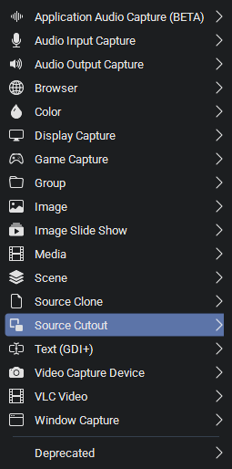
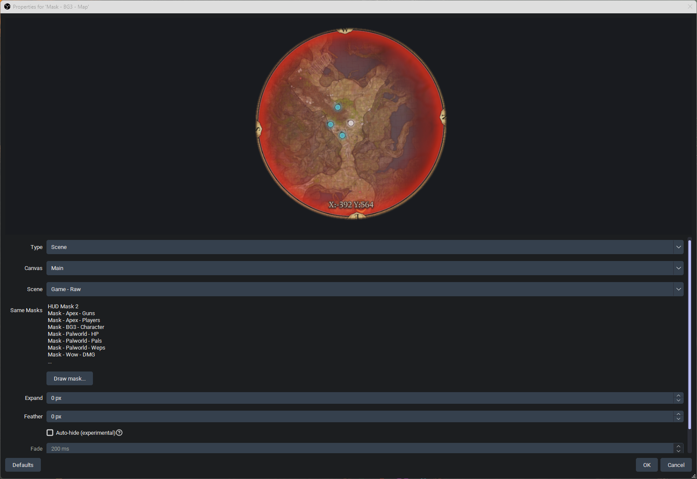
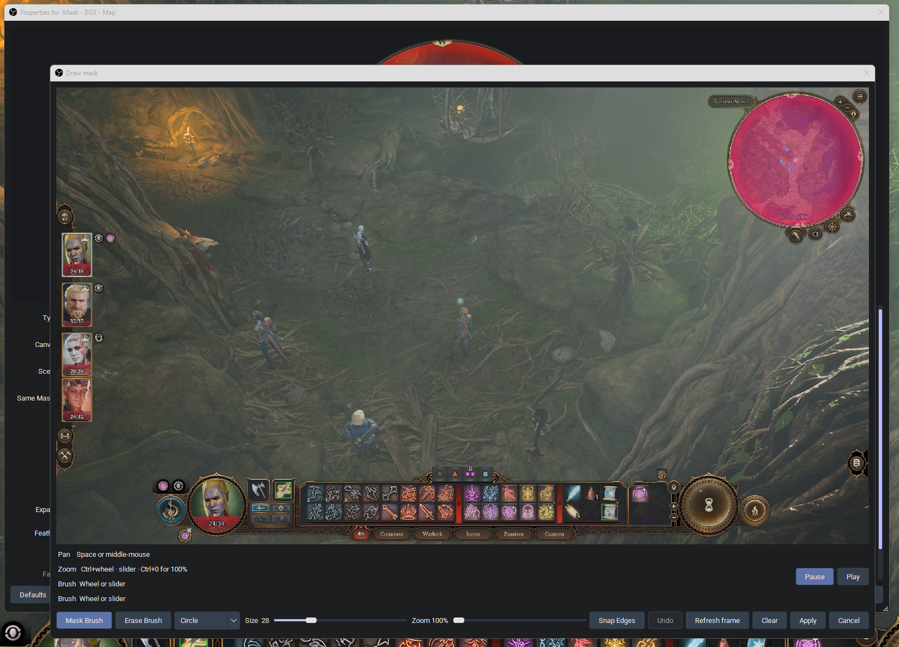
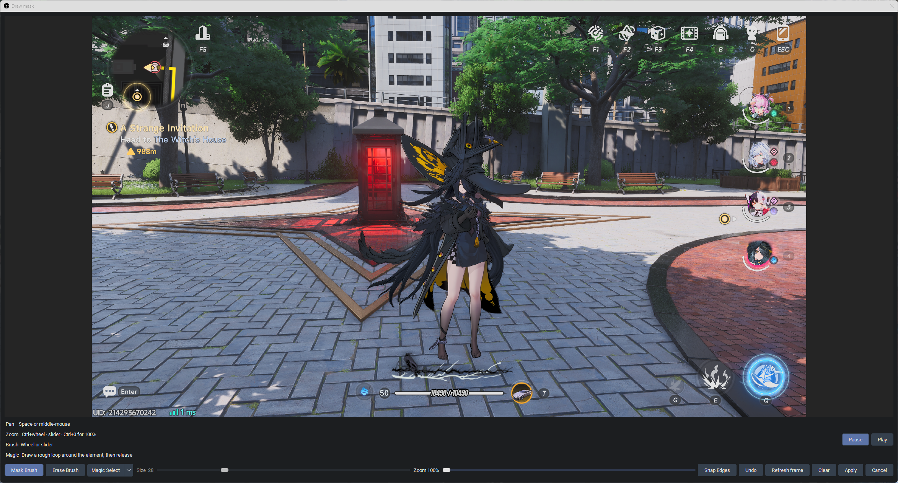
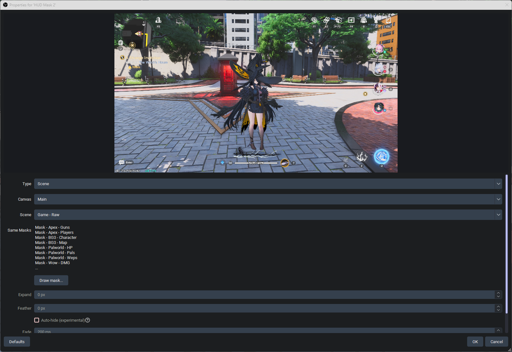

# Source Cutout

An [OBS Studio](https://obsproject.com/) plugin that cuts a piece out of any source so you can place and scale it on its own.

The usual use is **vertical streaming**: crop a 16:9 game into 9:16, then pull HUD the crop hid (minimap, bars, abilities) and park those pieces in the leftover space. It also works on a normal scene for any other cut-out. It is not tied to a specific game or to Aitum Vertical.

Free software (GPL-2.0-or-later). **Windows only** for now.

## Install

Requires OBS Studio 33+ on Windows 10/11 x64. OBS 32 will not load this build. Close OBS first.

1. Download the latest [release](https://github.com/Milzstream/OBS-Vertical-Mask-Generator/releases).
2. Run the installer (`source-cutout-<version>-windows-x64.exe`).

   Or unzip the portable zip and copy the `vertical-hud-mask` folder into `%ProgramData%\obs-studio\plugins\`. Portable OBS uses the `plugins` folder next to `bin`, not `obs-plugins`. The DLL sits beside the `data` folder.
3. Start OBS → **Add Source → Source Cutout**.

   

The installer writes under `%ProgramData%\obs-studio\plugins\vertical-hud-mask\` and removes leftover copies from `C:\Program Files\obs-studio\` and from the old `bin\64bit` layout. The folder and source id stay `vertical-hud-mask` so existing scenes and saved masks keep working. A portable OBS copy in a custom folder is not removed. Each time OBS starts, Source Cutout checks GitHub for a newer release and can download and start the installer. OBS closes for that install and reopens when it finishes.

## Use

1. Add a **Source Cutout** source.
2. Set **Type** to Source or Scene. For a scene, pick the **Canvas** first (main or an extra canvas such as Aitum Vertical), then the scene.
3. Pick the source or scene to sample. **Same Masks** lists other Source Cutouts already aimed at that target.

   

4. **Draw mask…**
   - **Mask Brush** / **Erase Brush**, then Circle or Square. Wheel or the Size slider sets the brush. Size is only for those two shapes.
   - **Line** — hold to place, pause to straighten, click near the start or press Enter to close.
   - **Fill** — click inside an outline (any brush or a closed line).
   - **Magic Select** — draw a rough loop around the element and release. If the MobileSAM model is installed it picks the element inside the loop. Otherwise it falls back to the old edge snap.
   - **Snap Edges** pulls a painted silhouette onto nearby contrast in the frame.
   - Ctrl+wheel or the zoom slider to zoom, Ctrl+0 for 100%. Space or middle-mouse to pan. Pause/Play freezes or resumes the live frame. Undo, Refresh, Clear, then **Apply**.

   

   

5. Place and scale the scene item. The plugin does not auto-layout the canvas.

**Expand** and **Feather** on the properties pane are available after a mask exists.

**Auto-hide** (off by default) makes the cut-out transparent when that HUD outline is gone, so loading screens and menus do not show through the hole. **Experimental:** it compares edges in the live frame, not the recorded outline placement, so unrelated scenery (cutscenes, menus) can still flicker it on and off. Draw the mask while the HUD is visible — that still is the outline reference. It does not click the OBS eyeball; a hidden scene item is skipped. **Fade** (0 ms is instant) and **Match** (how picky the outline compare is) are next to the checkbox. If it hides while the HUD is still on screen, open Draw mask, show the HUD, Refresh, then Apply.



## Build from source

Visual Studio 2022, CMake 3.28+, and a network connection the first time (the OBS SDK is downloaded). Set `HUD_MASK_SKIP_UPDATE=1` to skip the GitHub check while iterating.

```
cmake --preset windows-x64
cmake --build --preset windows-x64
ctest --test-dir build_x64 -C RelWithDebInfo --output-on-failure

Magic Select's element picker needs ONNX Runtime next to the plugin. The models ship in `data/models/`. Fetch the DLL once, then rebuild:

```
powershell -File .github/scripts/Fetch-MobileSAM.ps1
```

That places `onnxruntime.dll` under `third_party/onnxruntime/`. The build copies it next to the plugin. Reconfigure before packaging an installer so the DLL is included. Without the DLL, Magic Select still works and uses the edge snap.
```

Merging a version bump in `buildspec.json` to `main` tags that version and publishes a GitHub Release with the installer, portable zip, and source zip. CI runs the same `ctest` command on the Windows job.

## License

[GPL-2.0-or-later](LICENSE). Required to link libobs. No telemetry, no paid tier.

Design notes: [vision](docs/vision.md) · [architecture](docs/architecture.md) · [roadmap](docs/roadmap.md)
