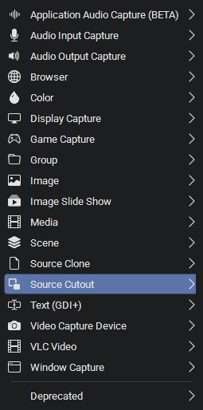
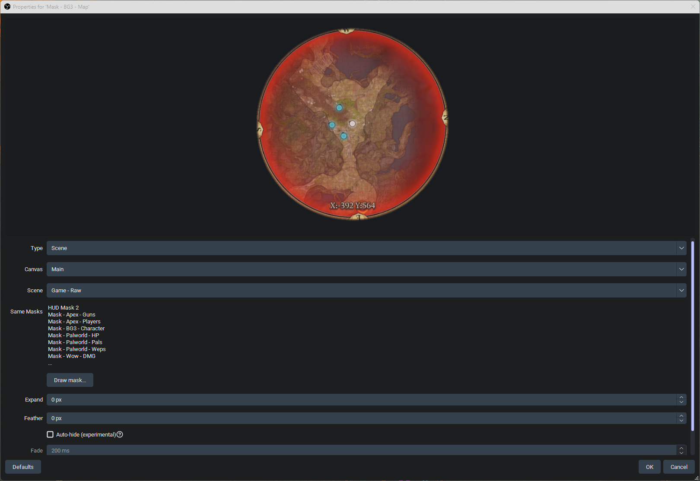
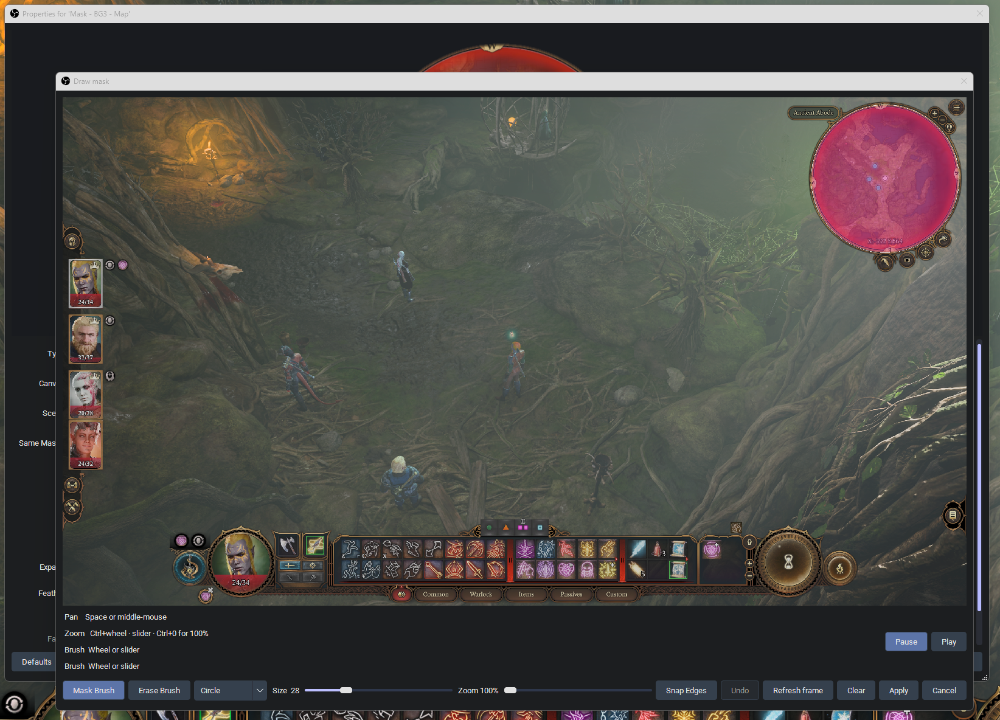
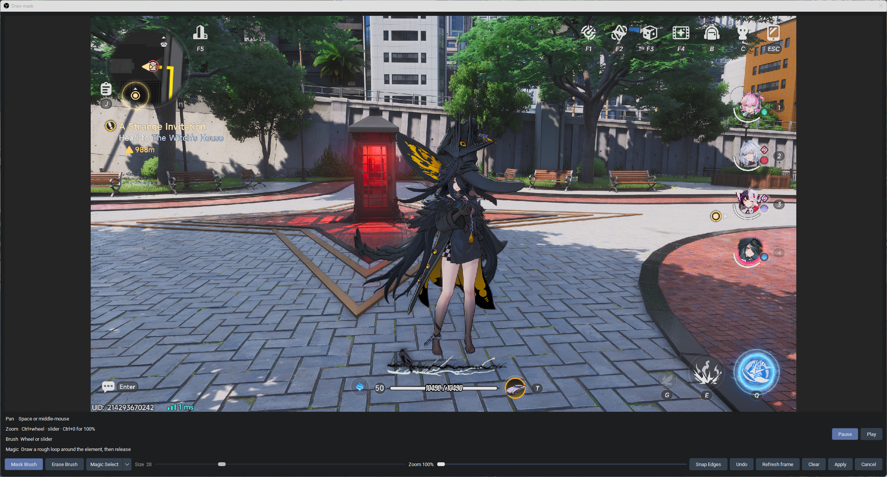
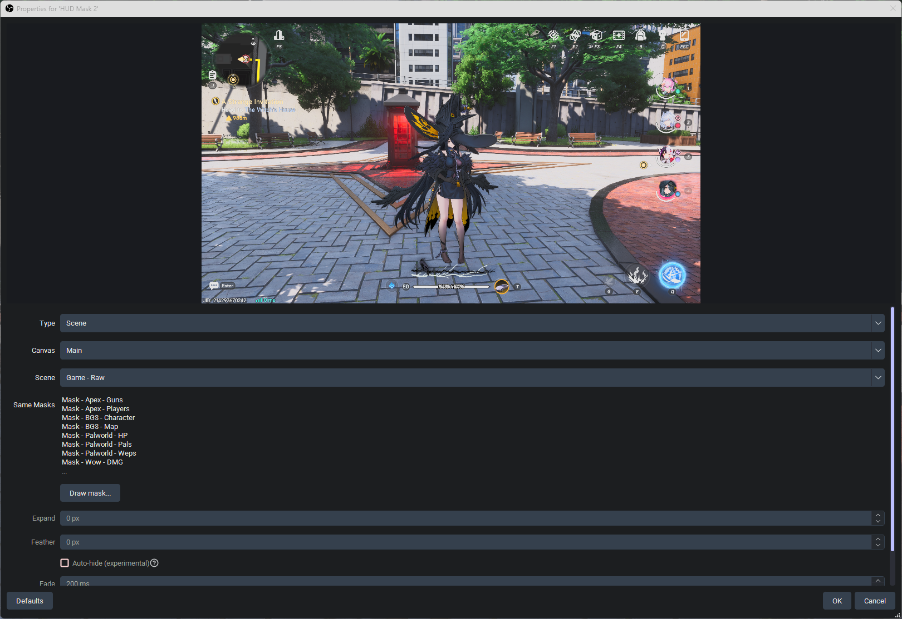

# Architecture

## Form factor

OBS plugin (C++/Qt), new **input source**. GPL-2.0-or-later.

| Choice | Why |
| --- | --- |
| Source, not filter | Needs its own scene item to drag and scale. |
| Sample any source | Game capture, scene, display, browser — same OBS API. |
| No game database | Settings persist on the source in the scene collection. |
| Custom Qt editor | Stock properties cannot host a live video + highlighter. |
| Windows first | CI publishes a Windows installer, portable zip, and source zip. macOS/Linux are later. |

## Add-source flow

```
Add Source → Source Cutout → name it
        ↓
Properties: Type, Canvas (if Scene), target, Same Masks, Draw mask…, Expand, Feather
        ↓
Draw mask editor
  live (or paused) view of the sampled source
  Mask / Erase · Circle · Square · Line · Shape · Fill · Magic Select
  Snap Edges · Undo · Redo · Refresh · Clear
  Apply
        ↓
source size = saved crop, scaled to the live filtered frame
user transforms the scene item
```









The properties sheet is small. Crop insets and the mask PNG path are stored on the source but not shown. There is no invert control and no Split into N.

## Runtime

```
Every frame (GPU), per visible Source Cutout
  sample target into a texrender
  scale saved crop insets from the authored filtered size to the live size
  draw that crop through the current mask (expand / feather already baked)
```

### Auto-hide



Optional, off by default. A plugin-wide cycle (~10 Hz) groups visible, auto-hide-on instances by sampled target and does **one** downsample/readback per target per cycle (round-robin when several targets are live). Each mask scores the **processed** paint (expand / feather) against the Draw mask still (Pearson on edges, small translation search). Interiors can change. Hidden scene items are skipped. Fade and a match slider live on the properties pane. The scene-item eyeball is never toggled; the source draws transparent instead.

## Highlight tools (setup only)

User paint is the mask. Optional **Snap Edges** walks the painted border and pulls it onto nearby frame contrast (any color). **Magic Select** asks MobileSAM to pick the element inside a rough loop. If the ONNX Runtime DLL or the models are missing, it falls back to edge snap (`mask_magic_shrinkwrap`). A pick the model runs and rejects is a miss, not a fallback. **Fill** floods an outline and swallows the ring. None of this runs at 60 fps.

Crop = bounding box of remaining opaque pixels, padded 32px. Mask PNG is saved at crop size as `masks/<source-uuid>.png` under the plugin config directory. A duplicate copies that PNG and its still/reference beside its own uuid. At draw time the saved insets are scaled from the authored filtered size to the live filtered size, so a base-resolution change does not shift the cut-out. A missing mask draws nothing. A missing auto-hide reference does not adopt the live frame.

## Persistence

On the source:

- Target kind, canvas uuid, source name
- Crop rect
- Mask PNG path (`masks/<uuid>.png`, or an older absolute path whose file name already matches the source uuid)
- Expand, feather
- Auto-hide, fade ms, match percent
- Presence still (`masks/<uuid>.ref`) next to the mask PNG

## Performance budget

All Source Cutout instances combined should cost less than an extra game capture.

- **Draw:** GPU sample + small masked blit per visible instance (same order as a source clone + crop).
- **Auto-hide off:** no analysis.
- **Auto-hide on:** one downsample/readback per unique visible target, not per mask. ≤10 Hz. Hidden items skipped.
- **Editor tools:** snapshot or paused frame only.

## Stream Suite

Normal OBS source. Intended placement: extra (vertical) canvas, sampling a main-canvas capture. Must also work on a single vanilla canvas. Do not link Stream Suite.

## Safety

- No injection, game memory, or telemetry
- GitHub `/releases/latest` only, for the optional update prompt
- Auto-hide off by default
- Scene-item visibility still overrides
